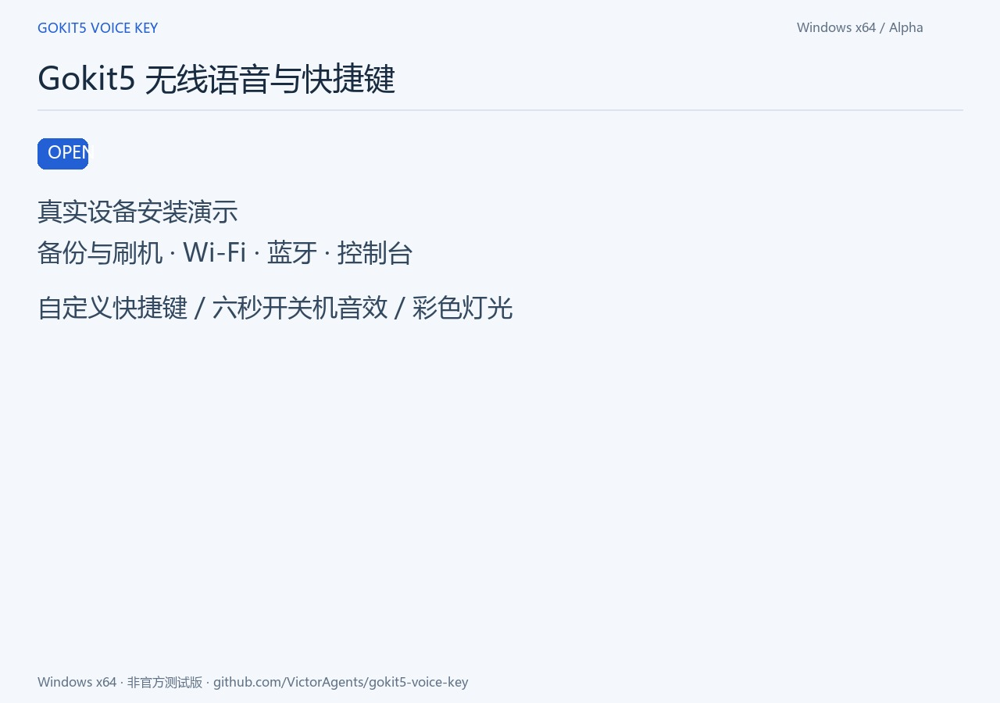

# Gokit5 Voice Key

把同款四键Gokit5变成 **无线语音输入按钮＋自定义蓝牙快捷键**。按住麦克风键说话，松手结束；声音走Wi-Fi，快捷键走蓝牙，还能设置开关机音效与彩色灯光。

**非官方项目 · Windows x64 · 0.13.0-alpha.1测试版**

[下载Windows程序](https://github.com/VictorAgents/gokit5-voice-key/releases/tag/v0.13.0-alpha.1) · [观看安装短片](https://victoragents.github.io/gokit5-voice-key/) · [录制说明](docs/demo.md) · [验证清单](RELEASE.json) · [许可证](LICENSE)

[](https://victoragents.github.io/gokit5-voice-key/)

## 三种连接有什么区别

| 连接 | 用途 | 日常需要吗 |
|---|---|---|
| USB数据线 | 识别、完整备份、刷入/更新固件、设置Wi-Fi | 配置好后可拔线，用电池 |
| 蓝牙 | 独立快捷键；接收端离线时发送右Alt备用 | 用快捷键时保持配对连接 |
| Wi-Fi | 将设备麦克风声音送到电脑 | 用设备麦克风时需要同一局域网 |

**配对蓝牙成功，不等于声音已经传入电脑。** 蓝牙不传本项目的设备麦克风音频，USB也不是日常麦克风通道。仅蓝牙快捷键可不启动电脑接收端。

## 适用设备和准备物品

- Windows10/11 x64，电脑有蓝牙和网络；普通用户无需Python、Arduino IDE或编译工具。
- 已确认接线的四键Wi-Fi版：电源、麦克风、＋、－；ESP32-S3、16MB Flash、8MB内置PSRAM、ES8311。外观相似或芯片相同不能证明GPIO兼容。
- 一根确认能传数据的USB-C线。只有充电功能的线不行。
- 设备连接2.4GHz Wi-Fi，电脑与它处于可互通的同一局域网。

刷入将替换原厂程序及云端功能。工具先检查型号、安全状态并备份；不支持的设备停止，不整片擦除、不烧eFuse、不绕过加密或安全启动。先保留自己的完整备份，不能拿别人的镜像恢复本机。

## 第一次安装

### 1．USB怎么连接

1. 从本仓库Releases下载 **Gokit5Community.exe**。源码ZIP用于开发，不是安装程序。
2. 用数据线将设备直接插电脑USB口并开机，一次只接一台；关闭占用串口的工具，旧接收端先停止，旧控制台保存并关闭。
3. 运行EXE，选择实际检测到的USB串口，例如COM7。串口号码只是示例，不要照抄。
4. 没有端口：换已验证的数据线、电脑直连USB口并确认开机。仍没有就停止排查，不凭猜测短接焊盘或刷其他板型固件。

### 2．准备电脑虚拟麦克风

安装器自动检测 **CABLE Input播放端＋CABLE Output录音端** 和48kHz双声道格式：

- 已就绪：跳过安装，不重复安装。
- 缺少：点“语音环境检测 / 安装”，阅读独立许可说明后，程序从官网下载、校验、解压并打开官方安装器；用户确认Windows管理员权限，在官方窗口点 **Install Driver**，结束后关闭安装器。
- 按[官方要求](https://vb-audio.com/Cable/)保存工作、重启电脑，再打开向导复检。程序不自动重启，也不把安装器退出码0当作一定已就绪。
- 已有驱动但端点不全：先提示重启/排查，不盲目覆盖安装。仅蓝牙快捷键不需要VB-CABLE。

VB-CABLE是VB-Audio的独立 **Donationware**，欢迎捐赠：[官网](https://vb-audio.com/Cable/)、[许可](https://vb-audio.com/Services/licensing.htm)。本项目不附带驱动二进制，不修改其许可、证书信任或系统默认音频。

### 3．完整备份并刷入

1. 核对四键板说明，勾选板型与备份确认，点击 **“一键备份并刷入”**。
2. 工具检查芯片、容量、安全状态，读取 **两份完整16MB Flash**；长度和SHA256一致、设备身份未变化后，才写入经过校验的编译固件。
3. 等显示完成，期间不拔USB、不关闭电脑。检查失败会停止，备份保留。
4. 程序安装到当前用户目录。**把备份另存到自己的U盘或独立介质**，不要只留在电脑同一块盘。

### 4．第一次怎么连接蓝牙

1. 设备开机，同时按住 **＋和－约3秒**，看到灯闪烁后松开。
2. Windows **设置→蓝牙和设备→添加设备→蓝牙**，选择 **Gokit5 Keys-xxxxxx**。
3. 后六位由每台设备生成，用来区别两台同款设备。等显示连接成功；后续通常自动重连，无需每次配对。
4. 失败时先在Windows删除旧/失败条目，再进入配对重加。配对手势不清除设备全部已存配对。

**＋／－同时短按**是可配置组合快捷键；**同时长按3秒**保留为配对，不发送短按组合键。

### 5．怎么连接Wi-Fi

1. 保持USB连接，在安装器选择这台设备，点击 **USB配网**。
2. 只在本机窗口输入 **2.4GHz Wi-Fi名称、密码**，点“通过USB配置Wi-Fi”，等明确显示配网成功。
3. 电脑可通过以太网或Wi-Fi联网，但必须与设备处于同一可互通局域网。访客网络隔离可能阻止连接。
4. 工具为每台设备生成独立鉴权密钥；Wi-Fi密码通过USB发给设备，不进入聊天、GitHub或公开源码。不要发布配网窗口截图。
5. 超时检查密码、2.4GHz、信号和网络隔离。必要时检查本程序的防火墙许可，不关闭整个防火墙，不映射设备端口到公网。

换Wi-Fi、密码或设备地址变化导致连接失败时，用USB重做配网。电脑地址/密钥存于本机对应设备目录。

蓝牙配对与Wi-Fi配网的先后顺序可互换，二者用途不同，都完成后再测试设备麦克风。

### 6．开始语音输入

1. 打开控制台，麦克风键保持 **RightAlt＋按住说话**，保存并等待同步；点“启动接收”，等显示设备已连接。
2. 在微信输入法等软件中选麦克风 **CABLE Output (VB-Audio Virtual Cable)**，快捷键设右Alt。CABLE Input是接收程序写入声音的播放端，不要选反。
3. 光标放到空白记事本正文，按住设备麦克风键，**听到就绪音结束后再说话**，松手应停止并输出文字。
4. USB下成功后拔线，再测试电池供电。设备声音仍需电脑后台接收、Wi-Fi和虚拟麦克风。
5. 勾选“登录Windows后自动后台接收语音”，以后不必手动打开控制台；窗口可关闭，后台继续接收。初始化失败会持续退避重试，主动点停止仍有效。

输入法“自动检测”在已测环境中也能工作，但不保证每台电脑都选对。无文字时先明确选CABLE Output；快捷键与输入法内部设置需分别确认。

## 日常操作与离线备用

| 操作 | 行为 |
|---|---|
| 在线时按住麦克风 | 设备采音，响就绪音后说话，松手停止 |
| 接收端未连接时按住麦克风 | 已配对蓝牙时直接按住右Alt，使用电脑麦克风；松手释放，不响设备就绪音 |
| ＋、－ | 默认不绑定，在控制台自定义 |
| ＋／－同时短按 | 自定义点按组合快捷键 |
| ＋／－同时长按3秒 | 进入蓝牙配对 |
| 电源按住至少2秒后松开 | 等关机音效播完再关机；USB仍供电时为休眠，按电源唤醒 |

备用需输入法实际选到电脑麦克风。“按住说话”每次按下选择通道，**同次长按不半途换源**；断线或恢复连接后，松手重按。离线备用固定右Alt，不跟随在线PTT快捷键改变。

长按有120秒安全上限，输入法可能另有限制。就绪音表示电脑音频与热键准备好，不等同云端识别服务状态或后续网络稳定性。

## 控制台能修改什么

修改后点 **保存并应用**，等 **已同步到设备**。初次同步需接收端和Wi-Fi；同步后的蓝牙快捷键保存在设备，可独立使用。窗口分按键、声音、灯光三页，可用滚轮查看。

### 按键页

| 设置 | 可修改内容 |
|---|---|
| 麦克风快捷键 | 右Alt、左Alt、Ctrl+Space等，也可在弹窗实际录入组合键 |
| 麦克风模式 | 按住说话＝设备麦克风＋离线右Alt备用；按住快捷键＝只发蓝牙按住/松开；点按快捷键＝只发一次 |
| ＋与－ | 各自设置空格、回车、撤销、复制粘贴、功能键、音量/媒体键等；点按或按住，留空不发 |
| ＋／－组合 | 同时短按的快捷键，只支持点按，长按保留配对 |
| 录入快捷键 | 支持单独修饰键或组合键，确认后填入 |
| 麦克风增益 | 电脑端0.25～16倍，观察电平调整，过高会失真 |
| 接收与登录启动 | 启动/停止后台、按需登录自动运行 |
| 虚拟麦克风检查 | 检查或准备官方VB-CABLE，已装可用则跳过 |

电源键不作为普通快捷键映射，以保留可靠开关机和电池供电控制。

### 声音页

- 开机、关机分别选：**关闭、轻提示、双音提示、自定义文件**；独立文件、同一音量0～100。
- 点击对应“导入音效…”，选本机不超过50MB音频；等上传完成自动选自定义，可试听，再保存启用。
- **小于等于6秒保留原时长，超过6秒只取开头6秒**；设备只保存转换后音效，原MP3不修改，有限幅与渐入渐出。
- PCM WAV直接支持。MP3/M4A/FLAC等需要电脑有FFmpeg，当前EXE不附带FFmpeg；没有时用WAV。本工具没有波形选区，想用中段需先自行剪辑。
- 录音/按键未松开时不试听或上传。上传中断、校验失败不替换有效文件；双槽存储，不格式化音效区。
- 音效存在设备，关电脑后仍保留。关机会等音效播完，最长约6秒。
- 音量0静音，录音就绪音沿用同一音量；关闭开机声音不会单独关闭录音就绪音。

### 灯光页和顶部状态

- 模板：**关闭、固定颜色、呼吸、彩虹流动、按键反馈**；自选颜色、亮度0～100。
- 空闲熄灯0～60秒，**0秒表示常亮**；空闲灯灭不是关机，按键可再次唤亮。配对会闪烁。
- 按键反馈模板：麦克风红、加减绿；充电芯片自身指示灯不一定受RGB模板控制。
- 顶部显示连接、蓝牙、最近按键、录音准备/录音、电平和充电信息，电池状态约5秒刷新。
- 只有有效采样才显示估算电压/百分比。部分已测板显示 **电量暂不可读**，不是0%，也不能给出电池健康度。

## 以后怎么更新固件

1. 下载新Release的EXE；旧控制台保存关闭、旧接收端停止，USB数据线接回并开机。
2. 选实际串口，确认同款板，点击 **已有本项目固件：备份并更新（保留配网、按键与音效）**。
3. 仍先两份完整备份、检查身份；只有当前分区与本版本一致，才 **仅写应用区**，保留NVS、配网、蓝牙配对、映射、灯光与音效。
4. 分区不同则停止，不强制仅更新。原厂首次改装用“一键备份并刷入”，不能把首次安装当作保留设置更新。
5. 完成后打开新版控制台，核对版本与连接，再测试快捷键、按住说话、音效、电池供电。

不自动下载并刷任意来源BIN，也不后台偷偷OTA。使用配套Release更新；恢复原厂走下面的原设备完整快照恢复。升级前另存个人备份与电脑配置。

## 备份、恢复、卸载与隐私

个人数据位于 `%LOCALAPPDATA%\Gokit5Community`：`app/`为程序，`devices/<设备ID>/`为各设备设置/地址/密钥/转换音效，`backups/<时间>/`为双份Flash/清单/本次日志，`logs/`为运行日志。正常接收不保存语音文件。

**不要上传这些个人目录、备份、日志或配网截图。** Release不含任何人的配置/Flash。局域网连接做鉴权，但PCM本身未加密；仅可信局域网使用，不开放公网。

恢复：USB接原设备，选择端口，点“从本机备份恢复”，选自己的`backup.json`。核对两份镜像长度、SHA和设备身份后完整写回；不能恢复到另一台。备份是安装前快照，不鉴定必为原厂，不含eFuse，原厂账号/云服务恢复效果需另外验证。

卸载前取消登录启动、停止接收、关闭窗口，再删除程序；保留`backups/`与`devices/`。VB-CABLE是独立驱动，卸载按官方步骤并重启，本工具不擅自移除它。

## 常见问题

| 现象 | 先检查 |
|---|---|
| USB无端口 | 数据线、直连USB、开机、串口占用，不只看充电灯 |
| 蓝牙失败 | ＋／－同时3秒，Windows移除失败/旧条目后重配 |
| 加减无效 | 是否留空、已保存同步、蓝牙已连接、点按/按住模式是否合适 |
| 录音界面有但无文字 | 输入法选CABLE Output、接收运行、局域网互通，对设备近距离说话 |
| 后台未开仍要用 | 蓝牙右Alt备用，对电脑说话；输入法需选电脑麦克风 |
| 无就绪音 | 纯快捷键/离线模式不响；在线检查按住说话与音量是否0 |
| 灯灭/按久失灵 | 先区别空闲熄灯、120秒限时、USB休眠；异常掉电仍需分别排查供电/程序 |
| 偶发断线 | 松手后等重连再按；已有间歇Wi-Fi超时记录，不承诺所有环境长期稳定 |
| 电量不可读 | 某些板采样无效，不表示电池0%或已损坏 |

一台电脑当前接收一台设备。切换前停止接收、关闭旧窗口，在安装器选择另一台再重开；数据隔离不表示同时多麦克风混音。

## 演示与验证状态

[安装介绍短片及录制说明](docs/demo.md)。真实步骤、加速等待与隐私遮挡会标清，未实测部分不以模拟成功画面替代。单元、打包、设备、第二台安装和恢复分别记录于 [RELEASE.json](RELEASE.json)。维护原型的语音、灯光、声音验收不自动等于新安装器全流程验收。

本次第二台同款设备已完成真实首次刷入、USB配网、首次蓝牙配对及控制台使用，用户确认无线转写、加减/组合快捷键和彩虹灯正常。录制中发现Wi-Fi重试超时，已补充断开重建连接和失败原因提示，最终发布包包含该修正。短时成功不表示所有网络环境长期稳定。

正式GUI的保留设置更新已在第二台完成同版本应用重写，双备份、分区检查、写入校验通过；重启后保留配网、蓝牙配对、声音/灯光选项和自定义音效。用户再次确认仅电池供电下开关机、六秒开机音效、语音和快捷键正常。完整恢复、全新Windows驱动安装、电脑重启自启和长期续航尚未实测。

## 开发构建

仅开发者需要Python3.12、Arduino CLI及esp32核心3.3.12；源码建议放英文路径。普通用户直接用EXE。

```powershell
python -m venv .venv
.\.venv\Scripts\Activate.ps1
python -m pip install -r requirements-build.txt
python -m unittest discover -s . -p "test_*.py" -v
arduino-cli compile --library firmware/libraries/BLE --fqbn "esp32:esp32:esp32s3:FlashSize=16M,PSRAM=opi,USBMode=hwcdc,CDCOnBoot=cdc" --build-path build/firmware firmware/voice_key
python tools/make_bundle.py build/firmware firmware_bundle
.\tools\build_windows.ps1
python tools/source_archive.py dist/Gokit5Community-source.zip
```

必须显式使用仓库的BLE库，修复重复HID报告UUID注册导致的崩溃，不修改全局Arduino库。见 [BLE修复说明](docs/ble-patch.md)。

原创代码 **GPL-3.0-or-later**，无担保；第三方保留各自许可，见 [THIRD_PARTY.md](THIRD_PARTY.md)和`licenses/`。二进制Release须同时提供对应源码和许可。品牌、原厂服务、VB-CABLE、用户导入音频不属于本项目GPL授权范围。
