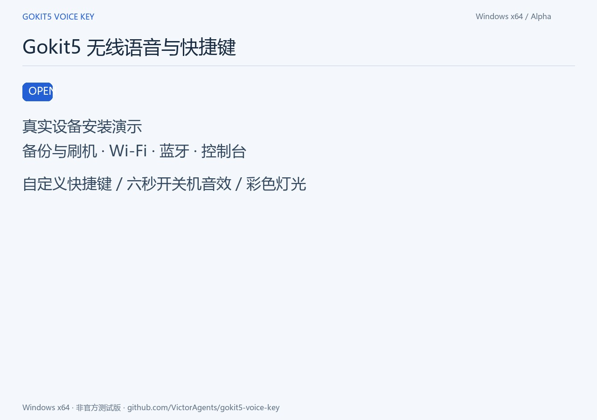

# 安装演示

[观看安装介绍短片](https://victoragents.github.io/gokit5-voice-key/) · [直接下载MP4](https://github.com/VictorAgents/gokit5-voice-key/releases/download/v0.13.0-alpha.1/install-demo.mp4)

2026-10-31，使用第二台同款四键Gokit5录制的真实操作剪辑。包含虚拟麦克风检测、USB完整双备份与刷入、USB配网、蓝牙配对说明、按键映射、六秒自定义音效、灯光、实际无线语音转写和保留设置更新。

- 电脑已有VB-CABLE，录像明确显示检测就绪并跳过；没有冒充全新Windows的驱动安装、管理员确认或重启验收。
- 等待和操作按片中标注加速，步骤经过剪辑、重新排序；不是一镜到底。
- 第二台首次蓝牙配对由用户真实完成且设备安全连接确认。Windows蓝牙窗口未录得有效画面，因此该段使用明确标注的步骤说明卡，没有制作假的成功界面。
- 安装途中发现Wi-Fi重试超时，修正后重新提交配网成功。最终发布包包含修正，视频配网采用修正后的真实片段。
- 自定义音效使用程序生成的中性演示音，不包含个人上传的歌曲。原始录屏不采集现场声音，视频以字幕说明操作。
- Wi-Fi输入区、完整设备标识、本地路径、日志及记事本其他标签均移除或遮挡；文件选择框里的无关输入整段不采用。原片仅留维护者本机，不上传。

短片约97秒，无需解压即可在页面播放，也提供MP4下载。保留设置更新后，用户再次确认第二台仅电池供电下开关机、六秒开机音效、语音和快捷键正常。

用户已确认第二台转写、加减/组合快捷键和彩虹灯正常。恢复原厂、全新Windows安装驱动、真实Windows重启自启、长期网络稳定与续航仍需分别验证，具体以[验证清单](../RELEASE.json)为准。
